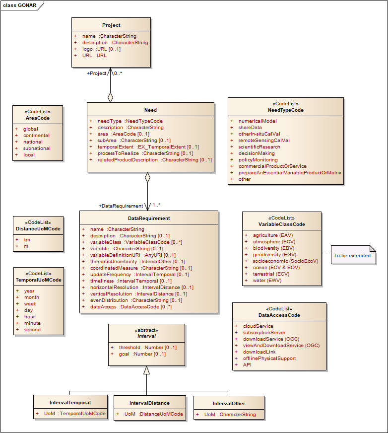
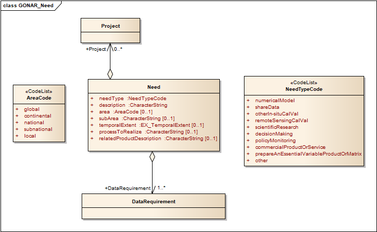
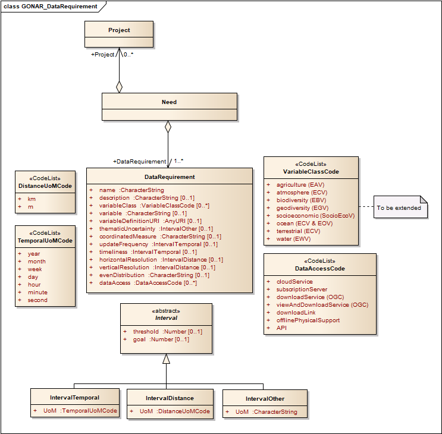
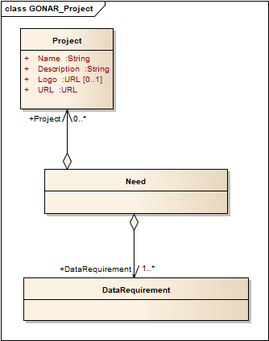

[[sc_data_model]]
== Requirements Class "Data Model"

=== Overview

The Data Model requirements class defines the data model classes that describe a need, a data requirement, a project and the relation among them. This model is designed from the point of view of the user. The user belongs to a particular project and has the need to extract some information and knowledge from some data that has some descriptive characteristics (see <<img_gonar_full>>). Most of the characteristics are optional and they are expected to be populated as the user knowledge of the characteristics evolves and increases.

include::../requirements/requirements_class_data_model.adoc[]

[#img_gonar_full,reftext='{figure-caption} {counter:figure-num}']
.GONAR UML class diagram

=== Need
A need is a problem or an issue to be addressed by using some in-situ observational data. A need can be characterized by classifying it in types, a particular spacial scale (global, national, local, etc.) covering a particular subarea and analyzing a particular time span. The process chain that needs to be executed over the data is only described as a summary, and sometimes a product is the result of the processing chain, and can be mentioned.

include::../requirements/data-model/need.adoc[]

[#img_need,reftext='{figure-caption} {counter:figure-num}']
.GONAR Need in UML

[#tbl_need,reftext='{table-caption} {counter:table-num}']
.GONAR_Need data type
[width = "100%",options="header"]
|===
|*Name* | *Definition*	| *Data type and values* | *Multiplicity and use*
|description | Brief narrative description of the need, normally for display to a human. | Character String type, not empty |  One (mandatory)
|needType | Needs for data, classified in several types.|  GONAR_NeedTypeCode (see <<tbl_need_type_code>>) | One (mandatory)
|area | Geographic scope or scale of the need.| GONAR_AreaCode (see <<tbl_area_code>>) |  Zero or one (optional)
|subArea | Name of the specific geographic area, region, locality, or any topographical feature related to the need item.  | Character String type, not empty |  Zero or one (optional)
|temporalExtent | Time period to be covered by the data (in years). | EX_TemporalExtent (ISO 19115-1:2014 B.3.1.3)^a^ |  Zero one or two (optional, if only one value is provided the other is assume to be "now")
|processToRealize | Summary of the methods or tasks that are necessary to realize the need. | Character String type, not empty |  Zero or one (optional)
|relatedProduct | Product to be created or outcome to be achieved as a result of the process. | Character String type, not empty|  Zero or one (optional)
4+| ^a^ Data time (YYYY-YYYY).
|===

[#tbl_need_type_code,reftext='{table-caption} {counter:table-num}']
.GONAR_NeedTypeCode code list
[cols="20,40",options="header"]
|===
|Property |Description
|numericalModel | Input or assessment of a numerical model
|shareData | Deployment of a sharing data system or service
|otherIn-situCalVal | Calibration and validation of other in-situ data
|remoteSensingCalVal | Calibration and validation of Remote Sensing products
|scientificResearch | Demonstration of a scientific hypothesis or answer a research question
|decisionMaking | Assist in a decision-making process
|policyMonitoring | Calculate a policy monitoring indicator or KPI
|commercialProductOrService | Provision of a commercial service derived from the data
|prepareAnEssentialVariableProductOrMatrix | Preparation of a harmonized Essential Variable product or matrix
|other | Any other need (only if the predefined types do not fit)
|===

[#tbl_area_code,reftext='{table-caption} {counter:table-num}']
.GONAR_AreaCode code list
[cols="20,40",options="header"]
|===
|Property |Description
|global | Applicable globally, to the whole Earth planet
|continental | Applicable to a given continent
|national | Applicable to a given country
|subnational | Applicable to a given region within a country
|local | Applicable locally
|===

=== Data requirement
A data requirement is specified by users in the context of a need by concrete technical characteristics of an in-situ observation collection that may or may not exist yet. 

Following the producers point fo view, the ISO 19131 specifies characteristics of products with single values that act a quality threshold. As an example, from the the producer point of view, the horizontal resolution should be inferior to a given value to be "approved". This Standard adopts the user point of view, where for the same characteristic there is more flexibility commonly expressed by two numbers providing an ideal value (sometimes called _goal_) and a compromise value (sometime called _threshold_). Anything in between these two numbers is still considered acceptable. Following the same example, a user knows that an horizontal resolution of 10m (_goal_) will generate very good results but it is prepared to accept 100m resolution (_threshold_) because it will still be possible to get some acceptable results, perhaps with some extra uncertainty.

A data requirement is characterized by the thematic variable captured, the coordinated measurements, the update frequency, the delivery timelines, the horizontal and vertical resolutions, its distribution in space and the data access mechanism. Some numerical characteristics are associated with their units of measurement.

include::../requirements/data-model/data-requirement.adoc[]

[#img_data_requirement,reftext='{figure-caption} {counter:figure-num}']
.GONAR Data Requirement in UML

  
[#tbl_data_requirement,reftext='{table-caption} {counter:table-num}']
.GONAR_DataRequirement data type
[width = "100%",options="header"]
|===
|*Name* | *Definition*	| *Data type and values* | *Multiplicity and use*
|name | Descriptive name of the data requirement. | Character String type, not empty |  One (mandatory)
|description | Brief narrative description of the data requirement, normally for display to a human. | Character String type, not empty |  Zero or one (optional)
|variableClass | Set of Essential Variables (EV)^a^ related to the theme of the data required.|  GONAR_VariableClassCode (see <<tbl_variable_class_code>>) | Zero or more (optional)
|variable | Name of the variable to be measured.|  Character String type, not empty | Zero or one (optional)
|variableDefinitionURI | URI of a definition of the variable.| Character String type, not empty | Zero or one (optional)
|thematicUncertainty | Level of uncertainty or error that can be accepted to address the need, expressed in standard units of measurement.|  GONAR_IntervalOther (see <<tbl_interval_other>>) | Zero, one or two (optional)^b^
|coordinateMeasure | Other variables that should be captured in the same location in a coordinated manner together with the main variable required.|  Character String type, not empty | Zero or one (optional)
|updateFrequency | Time range or how often the data must be captured, expressed in units of measurement of time.|  GONAR_IntervalTemporal (see <<tbl_interval_temporal>>) | Zero, one or two (optional)^b^
|timeliness | Time delay between the measurement acquisition and results accessibility required to address the need, expressed in units of measurement of time.|  GONAR_IntervalTemporal (see <<tbl_interval_temporal>>) | Zero, one or two (optional)^b^
|horizontalResolution | Minimum distance in the horizontal dimension that should separate two close measurements, expressed in units of measurement of distance.|  GONAR_IntervalDistance (see <<tbl_interval_distance>>) | Zero, one or two (optional)^b^
|verticalResolution | Minimum distance in the vertical dimension that should separate two close measurements, expressed in units of measurement of distance.|  GONAR_IntervalDistance (see <<tbl_interval_distance>>) | Zero, one or two (optional)^b^
|evenDistribution | How uniform the distribution of the samples would be. | Boolean | Zero or one (optional)
|dataAccess | Expected method to access to the required data. | GONAR_DataAccessCode (see <<tbl_data_access_code>>) | Zero or more (optional)
4+| ^a^ GONAR proposes to use the Essential Variables framework defined by Lehmann et al in 2020 (DOI 10.1080/17538947.2019.1636490) to classify the requirements thematically. Thus, each required variable to be observed must be associated to their respective class.

^b^ If only one value is provided is interpreted as the threshold value. If two values are provided the most restrictive is interpreted as the _goal_ value and the other as the _threshold_ value.
|===

[#tbl_variable_class_code,reftext='{table-caption} {counter:table-num}']
.GONAR_VariableClassCode code list
[cols="20,40",options="header"]
|===
|Property |Description
|agriculture (EAV) | Essential Agriculture Variables
|atmosphere (ECV) | Essential Climate Variables - Atmosphere
|biodiversity (EBV) | Essential Biodiversity Variables
|geodiversity (EGV) | Essential Geodiversity Variables
|socioeconomic (SocioEcoV) | Socioeconomic Variables
|ocean (ECV & EOV) | Essential Climate Variables - Ocean
|terrestrial (ECV) | Essential Climate Variables - Terrestrial
|water (EWV) | Essential Water Variables
|===

[#tbl_data_access_code,reftext='{table-caption} {counter:table-num}']
.GONAR_DataAccessCode code list
[cols="20,40",options="header"]
|===
|Property |Description
|cloudService | Data access service on the Internet
|subscriptionServer | Data access is allowed only to registered users
|downloadService (OGC) | OGC compliant service that supports data download
|viewAndDownloadService (OGC) | OGC compliant service that supports both data visualization and data download
|downloadLink | Direct web address (URL) to a downloadable file or dataset
|offlinePhysicalSupport | Data provided on a tangible format (e.g., DVD, USB, analogic data)
|API | Application Programming Interface
|===

==== Interval
The GONAR data model uses an abstract class named Interval to quantitatively express requirements through a threshold value and/or a target goal value. Three specializations are provided: IntervalTemporal, IntervalDistance, IntervalOther.

[#tbl_interval,reftext='{table-caption} {counter:table-num}']
.GONAR_Interval abstract class
[width = "100%",options="header"]
|===
|*Name* | *Definition*	| *Data type and values* | *Multiplicity and use*
|threshold |Minimum acceptable value for the requirement.|Number
|Zero or one (optional)
|goal |Desired target value for the requirement.|Number |Zero or one (optional)
|===

[#tbl_interval_temporal,reftext='{table-caption} {counter:table-num}']
.GONAR_IntervalTemporal specialization
[width = "100%",options="header"]
|===
|*Name* | *Definition*	| *Data type and values* | *Multiplicity and use*
|UoM |Temporal unit of measure. |GONAR_TemporalUoMCode (see <<tbl_temporal_uom_code>>) |One (mandatory) 
|===

[#tbl_interval_distance,reftext='{table-caption} {counter:table-num}']
.GONAR_IntervalDistance specialization
[width = "100%",options="header"]
|===
|*Name* | *Definition*	| *Data type and values* | *Multiplicity and use*
|UoM |Distance unit of measure. |GONAR_DistanceUoMCode (see <<tbl_distance_uom_code>>) |One (mandatory) 
|===

[#tbl_interval_other,reftext='{table-caption} {counter:table-num}']
.GONAR_IntervalOther specialization
[width = "100%",options="header"]
|===
|*Name* | *Definition*	| *Data type and values* | *Multiplicity and use*
|UoM |Any unit of measure. |Character String type, not empty |One (mandatory) 
|===

[#tbl_temporal_uom_code,reftext='{table-caption} {counter:table-num}']
.GONAR_TemporalUoMCode code list
[cols="20,40",options="header"]
|===
|Property |Description
|year | Calendar year
|month | Calendar month
|week | Calendar week
|day | Calendar day
|hour | Time interval of 60 minutes
|minute | Time interval of 60 seconds
|second | Base unit of time
|===

[#tbl_distance_uom_code,reftext='{table-caption} {counter:table-num}']
.GONAR_DistanceUoMCode code list
[cols="20,40",options="header"]
|===
|Property |Description
|km | Kilometer
|m | Meter
|===

=== Project
Context in which needs and requirements are originated and processes are executed to fulfill the needs and deliver the intended results. A project is participated by a user or a community of users working towards achieving the project objectives. 

Commonly, projects have an starting activity devoted to analyze project needs and specify data requirements. Other activities in the project may look for observational data that matches completely or partially the requirements or other activities may produce the data required when it cannot be found elsewhere.

While projects could be described in full, this is considered our of scope of this Standard and they are only provided as a means of classification and filtering of needs and data requirements. For example, project descriptions allow to query and create a view of all needs and requirements provided by a particular project or set of projects.

include::../requirements/data-model/project.adoc[]

[#img_project,reftext='{figure-caption} {counter:figure-num}']
.GONAR Project in UML

[#tbl_project,reftext='{table-caption} {counter:table-num}']
.GONAR_Project data type
[width = "100%",options="header"]
|===
|*Name* | *Definition*	| *Data type and values* | *Multiplicity and use*
|name | Name of the project. | Character String type, not empty |  One (mandatory)
|description | Brief narrative description of the project, normally for display to a human. | Character String type, not empty |  One (mandatory)
|logo | URL referencing a graphic representation or emblem used to visually identify the project. | Character String type, not empty |  Zero or one (optional)
|URL | URL of the project's primary online resource. | Character String type, not empty |  One (mandatory)
|===
